<!-- VISION CORE // profile of JAGATH123 · assets are generated by src/build.py -->

  

  

 


  

 


  <a href="https://github.com/JAGATH123/code-runner-production"></a>
  <a href="https://github.com/JAGATH123/student-feedback"></a>

  <a href="https://github.com/JAGATH123/COODU_TRUST"></a>
  <a href="https://github.com/JAGATH123/MRI-SCAN-U-NET-"></a>

  <a href="https://github.com/JAGATH123/SIGN-LANGUAGE-"></a>
  <a href="https://github.com/JAGATH123/EVIS-Emergency-Vehicle-Identification-System"></a>

 


  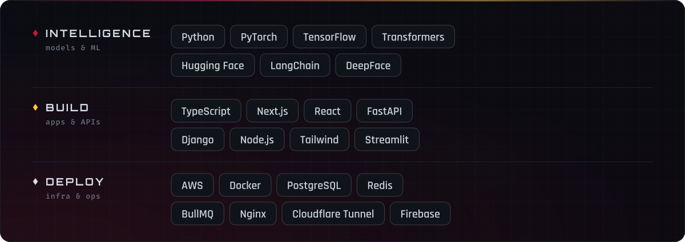

 


  
  

 


  <a href="https://jagath123.github.io/Jagath_portfolio/">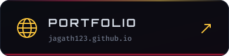</a>
  <a href="https://linkedin.com/in/Jagath-Guru">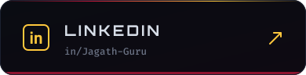</a>
  <a href="mailto:jagathguru134@gmail.com">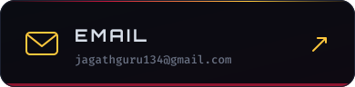</a>

 

  

  

